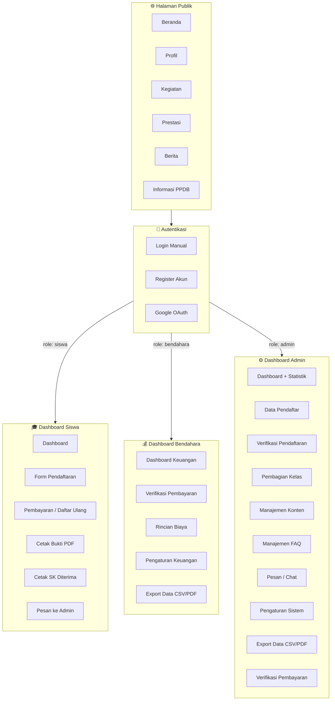
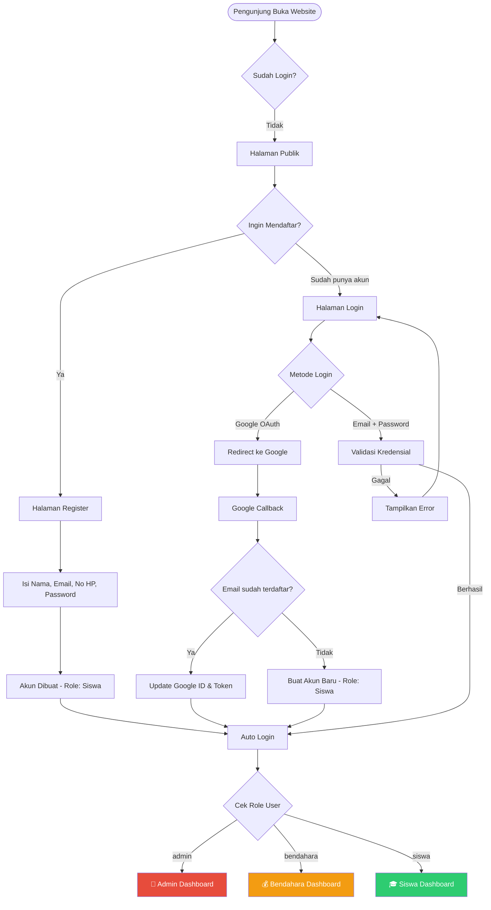
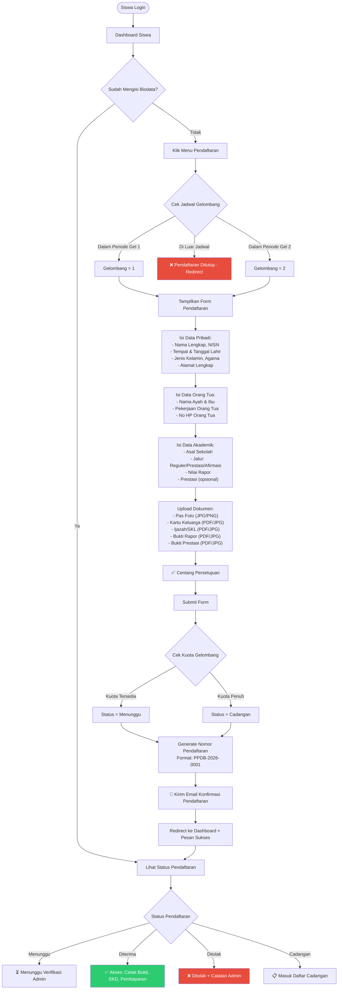
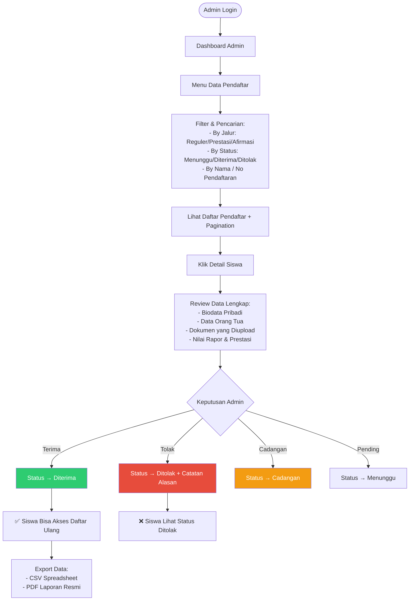
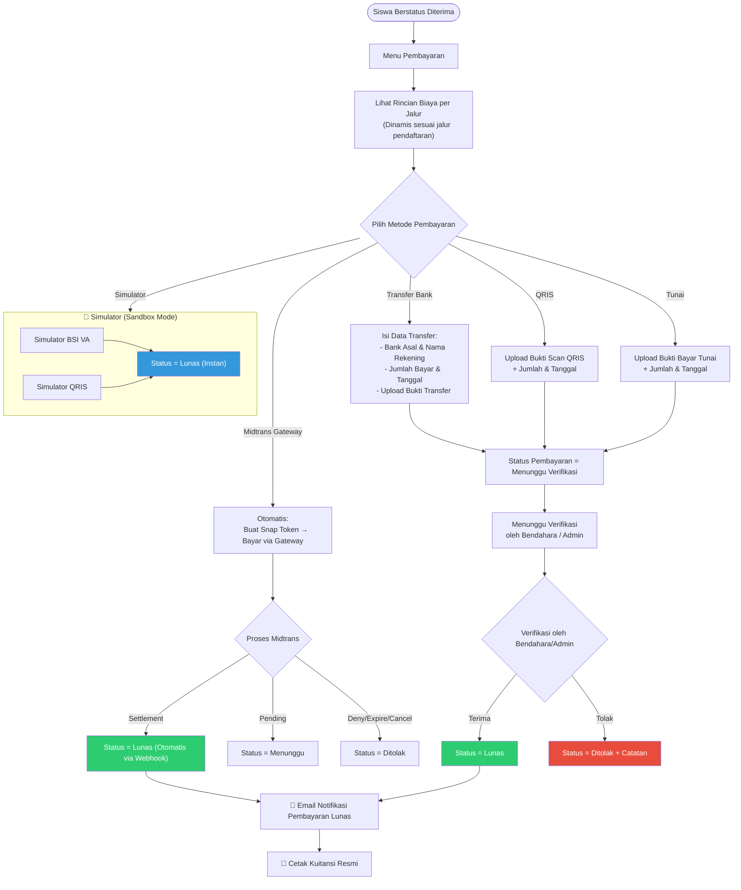
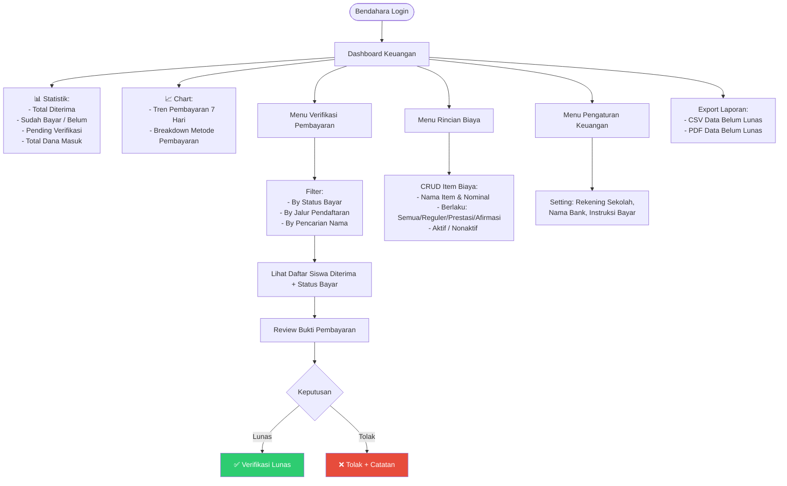
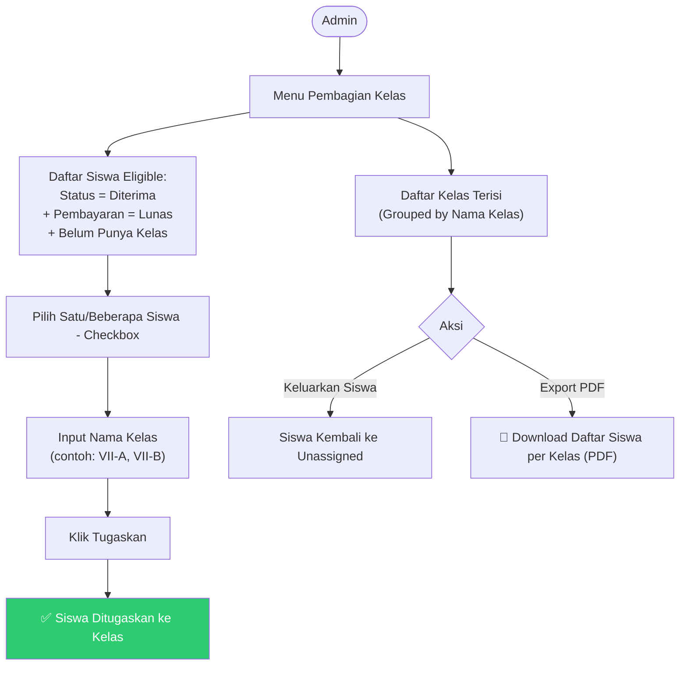
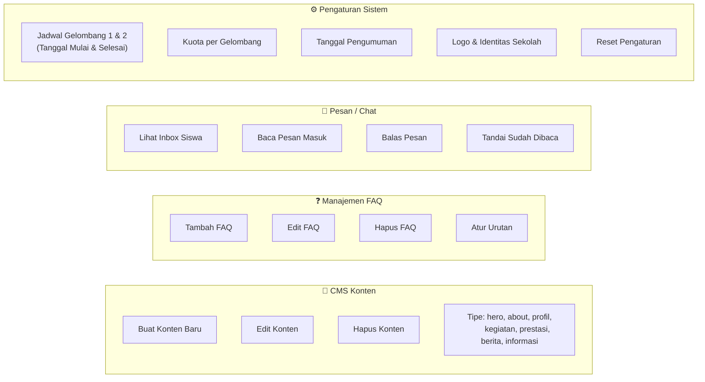
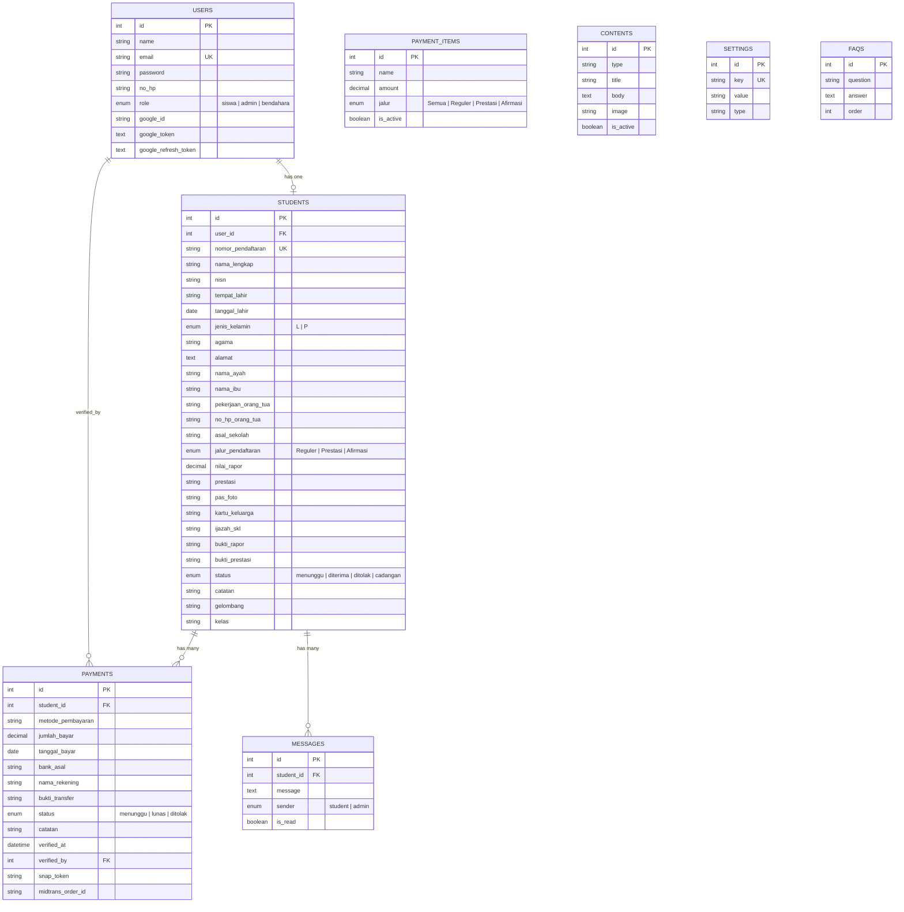
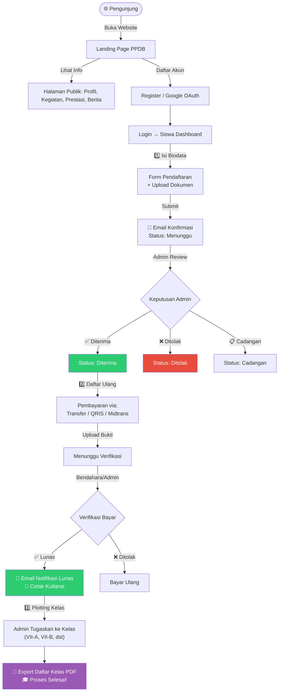

# 📊 Flowchart Sistem PPDB — SMP Muhammadiyah Kaliwiro

> Dokumen ini menggambarkan **seluruh alur kerja sistem PPDB** secara lengkap, mulai dari arsitektur, autentikasi, pendaftaran, pembayaran, hingga manajemen admin.

---

## 1. Arsitektur Sistem Keseluruhan

---

## 2. Alur Autentikasi & Role-Based Redirect

---

## 3. Alur Pendaftaran Siswa (Lengkap)

---

## 4. Alur Verifikasi Pendaftaran oleh Admin

---

## 5. Alur Pembayaran Daftar Ulang

---

## 6. Alur Kerja Bendahara

---

## 7. Alur Pembagian Kelas (Plotting)

---

## 8. Fitur Tambahan Admin

---

## 9. Entity Relationship Diagram (Database)

---

## 10. Alur Lengkap End-to-End (Overview)

---

## Ringkasan Fitur per Role

| No | Fitur | Siswa | Bendahara | Admin |
|:--:|-------|:-----:|:---------:|:-----:|
| 1 | Dashboard + Statistik | ✅ | ✅ | ✅ |
| 2 | Form Pendaftaran | ✅ | — | — |
| 3 | Upload Dokumen | ✅ | — | — |
| 4 | Pembayaran Daftar Ulang | ✅ | — | — |
| 5 | Cetak Bukti Pendaftaran | ✅ | — | — |
| 6 | Cetak SK Diterima (PDF) | ✅ | — | — |
| 7 | Cetak Kuitansi Pembayaran | ✅ | — | — |
| 8 | Kirim Pesan ke Admin | ✅ | — | — |
| 9 | Verifikasi Pendaftaran | — | — | ✅ |
| 10 | Verifikasi Pembayaran | — | ✅ | ✅ |
| 11 | Kelola Rincian Biaya (CRUD) | — | ✅ | — |
| 12 | Pengaturan Keuangan | — | ✅ | — |
| 13 | Pembagian Kelas (Plotting) | — | — | ✅ |
| 14 | CMS Konten Website | — | — | ✅ |
| 15 | Manajemen FAQ | — | — | ✅ |
| 16 | Balas Pesan Siswa | — | — | ✅ |
| 17 | Pengaturan Sistem | — | — | ✅ |
| 18 | Export CSV / PDF | — | ✅ | ✅ |

---

## Tech Stack

| Komponen | Teknologi |
|----------|-----------|
| Backend | Laravel (PHP) |
| Frontend | Blade Templates + Bootstrap 5 |
| Database | MySQL |
| Auth | Laravel Breeze + Google OAuth (Socialite) |
| Payment Gateway | Midtrans (Snap.js) + Simulator BSI/QRIS |
| PDF Generator | DomPDF (barryvdh/laravel-dompdf) |
| Email | Laravel Mail |
| Build Tool | Vite |
